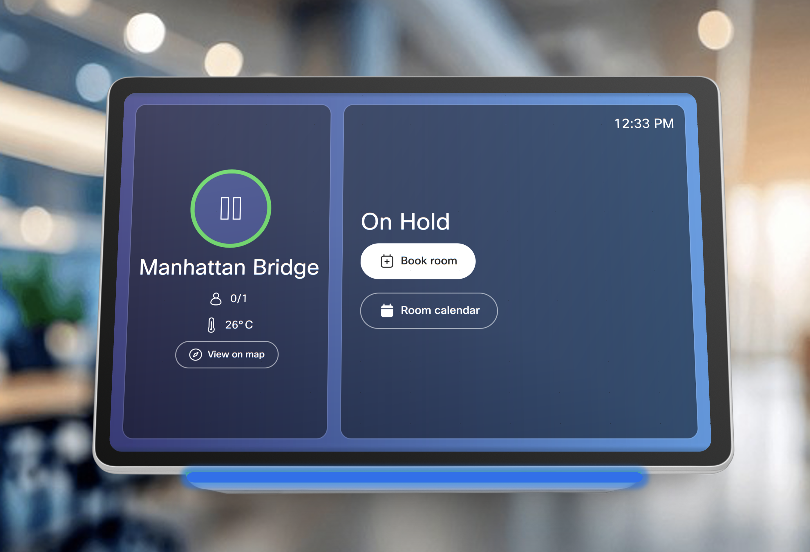

# On-Hold Macro
This macro updates the Cisco Navigator outside panel to On-Hold (blue) when requested by a user in Cisco Spaces. This includes the background image, workspace avatar, LED strip on the wall mount, and the main text. If no one books the room after 3 minutes or if a user presses "Book Room" from the outside panel, it will return to its default state.

## Options
There are three options for providing this capability. The differences between each is as follows;
1. Macro for paired Navigators. When your Navigator is paired (not standalone) to the codec. **Note** - for MTR's, most of the features will work however the ability to change the text to "On-Hold" is not available when paired and in MTR mode.
2. Macro for Navigators in standalone. In this case, messages between the codec and Navigator are sent via the Webex cloud. For MTR's this option works in full (unlike option 1). [Github repo here](https://github.com/dhenwood/OnHoldMacroMTR)
3. Workspace Integration. This option makes deploying the capability for a large fleet of devices the easiest. It is built on a server and made available for all devices (not requiring deploying the macro to every device). [Github repo here](https://github.com/dhenwood/Workspace-Integration)

This repo is for option 1 - devices running the native RoomOS version and the Navigator is paired.

## Setup
Install [the macro](https://github.com/dhenwood/OnHoldMacro/blob/main/OnHoldMacro.js) on each device requiring this capability.
